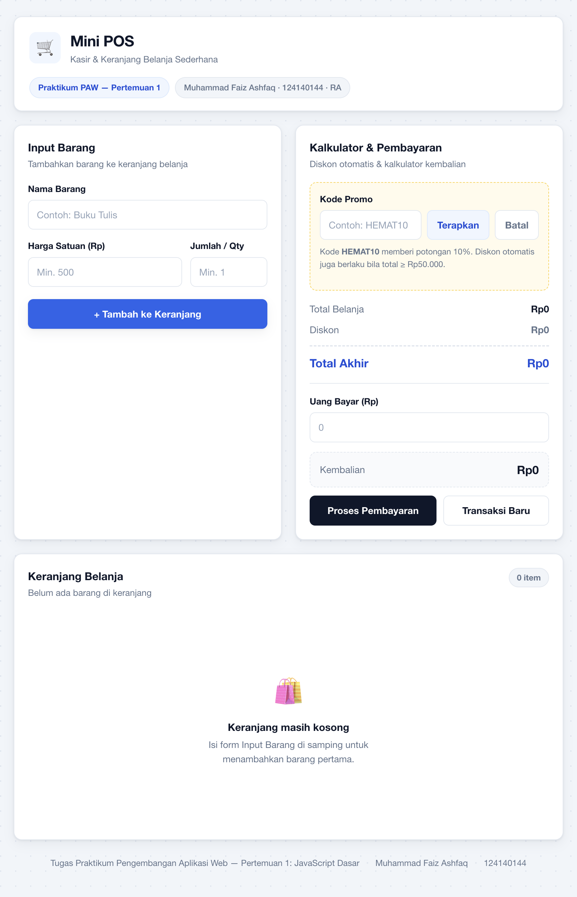
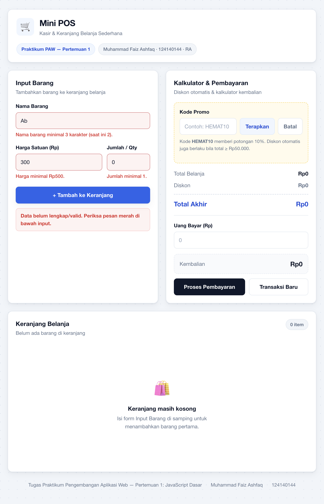
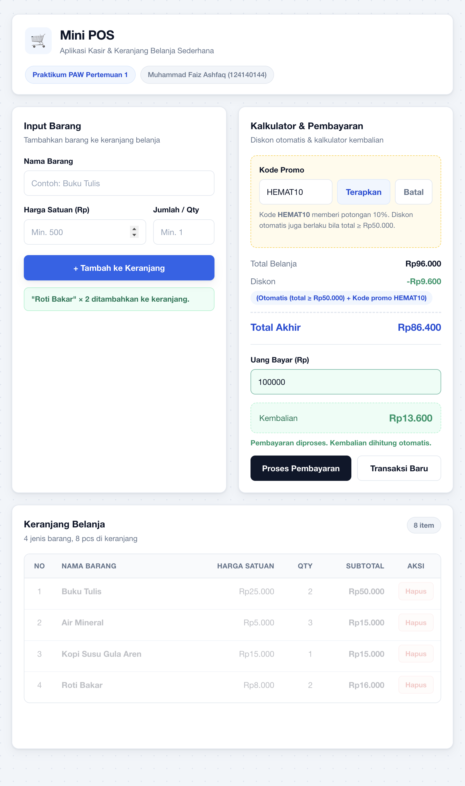
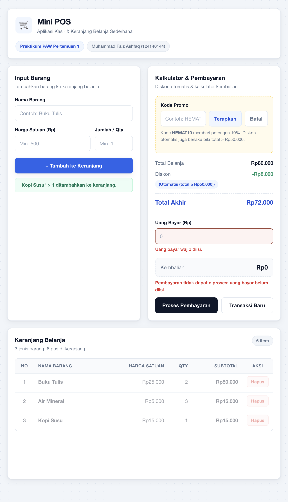

# 🛒 Mini POS — Kasir & Keranjang Belanja Sederhana

**Tugas Praktikum Pengembangan Aplikasi Web — Pertemuan 1: JavaScript Dasar**
Program Studi Teknik Informatika · ITERA · T.A. 2026/2027 Gasal

---

## 📋 Identitas

| | |
|---|---|
| **Nama Lengkap** | Muhammad Faiz Ashfaq |
| **NIM** | 124140144 |
| **Kelas Praktikum** | RA |
| **Pertemuan** | 1 — JavaScript Dasar |
| **Mata Kuliah** | Praktikum Pengembangan Aplikasi Web |
| **Repository** | `pemrograman_web_itera_124140144` |

---

## 📖 Deskripsi Aplikasi

**Mini POS** adalah aplikasi kasir dan keranjang belanja sederhana berbasis web yang
dibangun murni menggunakan **HTML, CSS, dan JavaScript murni (vanilla JS)** tanpa framework
maupun library eksternal.

Aplikasi ini mensimulasikan operasional kasir pada **kantin atau toko kampus**. Kasir
mengetikkan nama barang, harga satuan, dan jumlah barang pada form input. Setiap barang yang
berhasil ditambahkan langsung tampil di tabel keranjang lengkap dengan subtotal per baris,
jumlah item, subtotal, dan tombol hapus. Seluruh perhitungan keuangan — subtotal, total belanja,
diskon, total akhir, hingga kembalian — dihitung otomatis oleh JavaScript tanpa perlu reload
halaman.

### Tujuan Pembuatan

1. **Menerapkan validasi input form** — memastikan data barang yang masuk keranjang selalu
   valid (nama minimal 3 karakter, harga minimal Rp500, jumlah minimal 1).
2. **Menerapkan kalkulator keuangan otomatis** — subtotal, total belanja, diskon, dan
   kalkulator kembalian yang diperbarui otomatis setiap kali keranjang berubah.
3. **Menerapkan manajemen keranjang berbasis localStorage** — isi keranjang tetap tersimpan
   meskipun halaman di-refresh atau browser ditutup.

Studi kasus yang dipilih adalah **kasir kantin/toko kampus** dengan skenario diskon otomatis
untuk belanja di atas Rp50.000 dan kode promo `HEMAT10`.

### Alur Penggunaan

```
Input Barang ──▶ Validasi ──▶ Tambah ke Array Keranjang ──▶ Render Tabel
                    │                    │                        │
              (gagal: pesan           │                   Hitung Subtotal
               merah, barang          │                   Hitung Total Belanja
               TIDAK masuk)            ▼                   Hitung Diskon 10%
                                    Simpan ke               Hitung Total Akhir
                                   localStorage                  │
                                                               ▼
              Hapus Item ──▶ Hitung Ulang ◀─── Kembalian ◀─── Input Uang Bayar
                    │
                    ▼
          Transaksi Baru / Reset (kosongkan keranjang + localStorage)
```

---

## 🚀 Panduan Menjalankan

Aplikasi tidak memerlukan instalasi apa pun. Cukup buka `index.html` di browser.

### Cara 1 — Live Server (VS Code, *disarankan*)

1. Install extension **Live Server** di VS Code.
2. Buka folder `muhammadfaizashfaq_124140144_pertemuan1` di VS Code.
3. Klik kanan pada `index.html` → **Open with Live Server**.
4. Aplikasi terbuka di browser pada `http://127.0.0.1:5500/index.html`.

> Live Server disarankan agar `localStorage` berjalan pada konteks `http://`, bukan `file://`.

### Cara 2 — Live Server (XAMPP)

1. Salin folder proyek ke `htdocs/mini-pos`.
2. Jalankan **Apache** dari XAMPP Control Panel.
3. Buka `http://localhost/mini-pos/index.html`.

### Cara 3 — Server Lokal via Terminal

```bash
cd muhammadfaizashfaq_124140144_pertemuan1
python3 -m http.server 8000
```

Lalu buka `http://localhost:8000`.

### Cara 4 — Buka Langsung

Klik dua kali `index.html`, atau tekan `Ctrl + O` (Windows) / `Cmd + O` (macOS) di browser
lalu pilih file `index.html`.

> ⚠️ Pada beberapa browser, `localStorage` dapat dibatasi ketika file dibuka langsung lewat
> `file://`. Jika fitur penyimpanan tidak berfungsi, gunakan **Live Server**.

### Menjalankan File Latihan (`modul/`)

Buka salah satu file HTML di dalam folder `modul/` dengan cara yang sama, misalnya
`modul/01-variabel-kondisional.html`. Hasil setiap latihan juga dapat dilihat di **DevTools →
Console** (`F12`).

---

## ✅ Daftar Fitur

### 1. Validasi Form Input Barang — *[20%]*

- [x] **Nama Barang** wajib diisi dan minimal **3 karakter**
- [x] **Harga Satuan** wajib berupa angka positif, minimal **Rp500** (menolak 0, negatif, dan teks)
- [x] **Jumlah / Qty** wajib berupa bilangan bulat minimal **1** (menolak desimal)
- [x] Pesan error **merah** muncul tepat di bawah input yang salah
- [x] Input yang gagal diberi border merah + latar merah muda
- [x] Barang **dibatalkan masuk** keranjang bila ada satu saja field tidak valid
- [x] Banner ringkasan "Data belum lengkap/valid" ditampilkan
- [x] **Form otomatis di-reset** setelah data berhasil ditambahkan
- [x] Notifikasi sukses ("*Buku Tulis* × 2 ditambahkan ke keranjang")
- [x] Error hilang otomatis saat pengguna mengetik ulang

### 2. Kalkulator & Perhitungan Otomatis — *[30%]*

- [x] **Subtotal per baris** = Harga Satuan × Qty (dihitung saat render tabel)
- [x] **Total Belanja** = jumlah seluruh subtotal (otomatis, real-time)
- [x] **Diskon otomatis 10%** bila total belanja ≥ **Rp50.000**
- [x] **Kode promo `HEMAT10`** untuk diskon 10% saat total belum mencapai Rp50.000
- [x] Keduanya **tidak ditumpuk** — potongan maksimal 10%
- [x] Ditampilkan **nominal diskon** dan **total akhir** yang harus dibayar
- [x] Label alasan diskon (Otomatis / Kode promo) selalu tampil
- [x] **Kalkulator kembalian**: `Kembalian = Uang Bayar − Total Akhir`
- [x] **Pembayaran DIBLOKIR bila uang bayar belum diisi** — muncul pesan merah *"Uang bayar wajib diisi."* di bawah input + *"Pembayaran tidak dapat diproses: uang bayar belum diisi."*
- [x] **Pembayaran DIBLOKIR bila keranjang masih kosong**
- [x] Pembayaran **DIBLOKIR bila uang bayar tidak valid** (teks / negatif)
- [x] Jika uang **kurang**, tampilkan keterangan *"Uang belum mencukupi! Kurang Rp…"* (kotak merah)
- [x] **Saat uang kurang, kolom Kembalian tetap Rp0** — nominal yang tampil hanyalah
      nilai kembalian yang benar-benar bisa diberikan; besaran kekurangan
      disampaikan pada pesan, bukan dipotong sebagai kembalian
- [x] Perhitungan kembalian **real-time** setiap kali angka uang bayar diketik
- [x] Input uang bayar diberi penanda merah saat gagal, dan fokus otomatis ke kolom uang bayar
- [x] Seluruh nominal diformat otomatis ke Rupiah (`Rp96.000`) via `Intl.NumberFormat('id-ID')`

### 3. Manajemen List & LocalStorage — *[30%]*

- [x] Tabel keranjang interaktif dengan kolom **No, Nama Barang, Harga Satuan, Qty, Subtotal, Aksi**
- [x] Tombol **Hapus** di setiap baris barang.
- [x] Setelah dihapus, **total belanja, diskon, dan total akhir langsung dihitung ulang**
- [x] Animasi transisi saat baris dihapus / barang ditambahkan
- [x] **Penyimpanan persisten**: `localStorage.setItem()` dengan `JSON.stringify()`
- [x] **Pemuatan ulang**: `localStorage.getItem()` dengan `JSON.parse()` saat halaman dibuka
- [x] **Isi keranjang tidak hilang saat halaman di-refresh** atau browser ditutup
- [x] Tombol **Transaksi Baru** untuk mengosongkan keranjang + membersihkan `localStorage`
- [x] Konfirmasi dialog sebelum menghapus data (mencegah kehilangan tak sengaja)
- [x] Penghitung **jumlah jenis barang & total pcs** pada header keranjang
- [x] Tampilan **empty state** ("Keranjang masih kosong") saat tidak ada barang

### 4. Desain Antarmuka (UI/UX) — *[10%]*

- [x] Tata letak 2 kolom (form + kalkulator di kiri, keranjang di kanan) pada layar lebar
- [x] **Responsif** penuh: 3 breakpoint (desktop ≥941px, tablet 621–940px, mobile ≤620px)
- [x] Pada mobile, tabel keranjang berubah menjadi **kartu** (stacked card layout)
- [x] Format Rupiah konsisten di seluruh tampilan
- [x] Animasi & transisi halus (hover, focus, masuk/hapus baris)
- [x] Indikator warna: hijau = valid/sukses, merah = error/kurang bayar, biru = aksi utama
- [x] Dukungan **cetak struk** (`@media print` — form dan tombol disembunyikan)
- [x] Seluruh antarmuka berbahasa Indonesia
- [x]Aksesibilitas: atribut `aria-live`, `aria-invalid`, dan fokus otomatis ke input berikutnya

### 5. Struktur Kode & Dokumentasi — *[10%]*

- [x] Pemisahan file rapi: `index.html`, `style.css`, `script.js`
- [x] Penamaan fungsi & variabel konsisten dalam gaya **camelCase**
- [x] Penggunaan `const` untuk nilai tetap dan `let` untuk nilai yang berubah (menghindari `var`)
- [x] Penggunaan operator **`===`** (bukan `==`) untuk perbandingan
- [x] Fungsi-fungsi terpisah: `validasiFormBarang()`, `hitungDiskon()`, `hitungKembalian()`,
      `periksaPembayaran()`, `simpanKeranjang()`, `muatKeranjang()`, `renderKeranjang()`,
      `transaksiBaru()`
- [x] Komentar JSDoc pada setiap fungsi penting
- [x] Sanitasi input nama barang dengan `escapeHtml()` (mencegah XSS)
- [x] Penanganan error (`try/catch`) pada operasi `localStorage` dan `fetch`
- [x] `README.md` lengkap dengan dokumentasi dan screenshot

---

## 🖼️ Tangkapan Layar (Screenshot)

### 1. Tampilan Awal — Form Input Barang & Kalkulator (Keranjang Kosong)



Halaman awal menampilkan form input barang (Nama, Harga Satuan, Qty), panel kalkulator dengan
fitur kode promo, serta kondisi keranjang masih kosong (*empty state*).

### 2. Tampilan Validasi Error



Saat data tidak valid (nama "Ab" hanya 2 karakter, harga Rp300 di bawah minimum, jumlah 0),
setiap input yang salah diberi **border merah + pesan error merah** di bawahnya, banner
"Data belum lengkap/valid" muncul, dan **barang tidak masuk ke keranjang**.

### 3. Hasil Perhitungan Kalkulator & Tabel Keranjang



Empat barang berhasil ditambahkan ke keranjang. Aplikasi otomatis menghitung:
**Total Belanja Rp96.000** → **Diskon −Rp9.600** (otomatis + kode promo `HEMAT10`) →
**Total Akhir Rp86.400**, dan dengan uang bayar Rp100.000 menghasilkan **Kembalian Rp13.600**.

### 4. Pembayaran Ditolak — Uang Bayar Belum Diisi



Saat kolom **Uang Bayar** masih kosong lalu tombol **Proses Pembayaran** ditekan, transaksi
**diblokir**: input uang bayar diberi border + pesan merah *"Uang bayar wajib diisi."*, dan
ditampilkan keterangan *"Pembayaran tidak dapat diproses: uang bayar belum diisi."* Kotak
kembalian **tidak berubah menjadi hijau** — transaksi hanya dianggap berhasil bila uang
bayar sudah diisi, valid, dan mencukupi.

---

## 🔍 Penjelasan Teknis Singkat

### A. Penanganan Validasi Input

Validasi dijalankan di dalam fungsi `validasiFormBarang()` yang dipanggil pada event
`submit` form. Fungsi ini memeriksa ketiga field secara independen dan mengembalikan objek
`{ valid, data }`.

```javascript
function validasiFormBarang() {
  let namaValid = false;

  // Nama: wajib diisi + minimal 3 karakter (setelah di-trim)
  if (namaMentah.trim() === "") {
    tampilkanError(el.namaBarang, "Nama barang wajib diisi.");
  } else if (namaMentah.trim().length < 3) {
    tampilkanError(el.namaBarang, `Nama barang minimal 3 karakter (saat ini ${namaMentah.trim().length}).`);
  } else {
    tampilkanError(el.namaBarang, "");
    namaValid = true;
  }
  // ... (pemeriksaan harga & qty dengan pola yang sama)

  return {
    valid: namaValid && hargaValid && qtyValid,
    data: { nama: namaMentah.trim(), harga, qty },
  };
}
```

Tiga lapis pemeriksaan pada setiap field:

| Lapis | Jenis Field | Pemeriksaan |
|---|---|---|
| 1 | Kosong | `value.trim() === ""` → "wajib diisi" |
| 2 | Tipe data | `Number.isFinite(Number(x))` → menolak teks |
| 3 | Batas nilai | `>= 3` karakter / `>= 500` / `Number.isInteger` & `>= 1` |

Pada handler `submit`, kondisi penentu adalah:

```javascript
if (!hasil.valid) {
  // Barang TIDAK masuk keranjang, hanya tampil pesan error
  return;
}
tambahKeKeranjang(hasil.data);  // hanya dieksekusi bila semua field valid
```

Fungsi `tampilkanError(input, pesan)` bekerja dua arah — ketika `pesan` berisi teks, input
mendapat kelas CSS `gagal-diisi` (border + latar merah) dan `aria-invalid="true"`; ketika
pesan kosong, kelas tersebut dihapus. Pendekatan yang sama diterapkan untuk kode promo dan
uang bayar. Form baru di-reset (`formBarang.reset()`) **setelah** validasi dinyatakan berhasil,
sehingga data yang diketik pengguna tidak hilang saat masih ada kesalahan.

### B. Algoritma Kalkulator Keuangan

Seluruh perhitungan berada di **satu sumber kebenaran**: array `keranjang`. Setiap kali array
berubah, fungsi `hitungSemua()` dipanggil untuk menggambar ulang seluruh angka.

```
hitungTotalBelanja()  →  reduce((total, item) => total + item.harga * item.qty, 0)
          ↓
hitungDiskon(total)   →  berlaku bila (total ≥ Rp50.000) ATAU (kode promo HEMAT10)
                        nominal = berlaku ? Math.round(total * 0.1) : 0
          ↓
totalAkhir           =  total − nominal diskon
          ↓
hitungKembalian()    →  kembalian = uangBayar − totalAkhir
                        kembalian < 0  → Kembalian ditampilkan Rp0 (tidak ada kembalian)
                        kembalian = 0  → "Pembayaran pas, tidak ada kembalian."
                        kembalian > 0  → tampilkan nominal kembalian (hijau)
```

Kode diskon:

```javascript
function hitungDiskon(total) {
  const otomatis = total >= BATAS_TOTAL_DISKON;      // Rp50.000
  const alasan = [];

  if (otomatis) alasan.push(`Otomatis (total ≥ ${formatRupiah(BATAS_TOTAL_DISKON)})`);
  if (promoTerpakai) alasan.push(`Kode promo ${KODE_PROMO_VALID}`);

  const berlaku = otomatis || promoTerpakai;         // OR, bukan penjumlahan — maks 10%
  const nominal = berlaku ? Math.round(total * PERSEN_DISKON) : 0;

  return { berlaku, nominal, alasan };
}
```

Menggunakan operator `||` (bukan penjumlahan dua diskon) memastikan kasir tidak bisa
mendapatkan diskon 20% dengan menggabungkan kode promo dan ambang otomatis. Setiap
perubahan — baik menambah barang, menghapus barang, menerapkan promo, maupun mengetik uang
bayar — memicu `hitungSemua()`, sehingga angka di layar **selalu sinkron** dengan isi
keranjang tanpa perlu tombol hitung ulang.

Render tabel memakai `map()` + `join("")` sehingga penomoran baris (`index + 1`) selalu
otomatis menyesuaikan, dan `escapeHtml()` dipakai pada nama barang agar karakter HTML tidak
dapat merusak tampilan halaman.

#### Validasi Pembayaran (pemblokiran transaksi)

Perhitungan kembalian bersifat *real-time* (otomatis saat mengetik), namun **eksekusi
pembayaran** hanya boleh berjalan bila syarat terpenuhi. Aturan ini diperiksa oleh fungsi
`periksaPembayaran()` yang mengembalikan objek `{ valid, tipe, pesan }`:

| # | Syarat gagal | `tipe` | Tindakan |
|---|---|---|---|
| 1 | Keranjang masih kosong | `keranjangKosong` | Batalkan, fokuskan ke input barang |
| 2 | **Uang bayar belum diisi** | `uangKosong` | Tandai field merah, fokuskan ke input uang bayar |
| 3 | Uang bayar bukan angka / negatif | `uangTidakValid` | Tandai field merah, fokuskan ke input uang bayar |
| 4 | Uang bayar < total akhir | `uangKurang` | Kotak kembalian jadi merah, fokuskan ke input uang bayar |
| 5 | Semua syarat terpenuhi | `ok` | Tandai field hijau, tampilkan kembalian |

```javascript
el.btnProsesBayar.addEventListener("click", () => {
  hitungKembalian();                       // segarkan tampilan
  const hasil = periksaPembayaran();       // apakah boleh diproses?

  el.kembalianNote.textContent = hasil.pesan;
  el.kembalianNote.style.color = hasil.valid ? "var(--warna-hijau)" : "var(--warna-merah)";

  if (hasil.tipe === "uangKosong") {
    tampilkanError(el.uangBayar, "Uang bayar wajib diisi.");
    el.uangBayar.focus();
    return;                                // TRANSAKSI DIBATALKAN
  }
  // ... penangan tipe lainnya
});
```

Dengan pola `return` di setiap cabang gagal, transaksi **tidak pernah** ditandai berhasil
apabila nominal uang bayar kosong, tidak valid, atau kurang dari tagihan. Pesan error di
bawah input otomatis hilang begitu kasir mulai mengetik ulang (`event "input"`), sehingga
antarmuka tetap responsif.

### C. Mekanisme Serialisasi localStorage

Data keranjang disimpan sebagai **JSON string** agar bisa dibaca ulang setelah halaman
dimuat ulang.

```javascript
// --- MENYIMPAN ---
function simpanKeranjang() {
  try {
    localStorage.setItem(KUNCI_STORAGE, JSON.stringify(keranjang));
  } catch (error) {
    console.error("Gagal menyimpan keranjang:", error);
  }
}

// --- MEMUAT ---
function muatKeranjang() {
  try {
    const dataTersimpan = localStorage.getItem(KUNCI_STORAGE);
    if (!dataTersimpan) return;

    const parsed = JSON.parse(dataTersimpan);
    if (Array.isArray(parsed)) {
      keranjang = parsed.map((item) => ({ id: item.id, nama: String(item.nama ?? ""), ... }));
      idBerikutnya = keranjang.reduce((maks, item) => Math.max(maks, item.id), 0) + 1;
    }
  } catch (error) {
    localStorage.removeItem(KUNCI_STORAGE);  // data rusak → mulai dari keranjang kosong
  }
}
```

Tiga hal penting pada mekanisme ini:

1. **Kunci khusus** — `minipos_keranjang_124140144` agar tidak bentrok dengan data aplikasi lain.
2. **Validasi saat muat** — `Array.isArray()` memastikan data bertipe array, dan setiap item
   dinormalisasi (`Number(item.harga) || 0`) sehingga data yang rusak tidak menyebabkan crash.
3. **`try/catch`** — `localStorage` dapat gagal (mode privat, kuota penuh, JSON rusak). Jika
   terjadi, error dicatat ke console dan aplikasi tetap berjalan dengan keranjang kosong.

Fungsi `transaksiBaru()` melakukan **`localStorage.removeItem()`** sehingga data benar-benar
dibersihkan — bukan hanya dihapus dari layar. Urutan pembaruan pada setiap aksi pengguna:

```
ubah keranjang → simpanKeranjang() → renderKeranjang() → hitungSemua()
                   (persistensi)      (tampilan tabel)    (angka & kembalian)
```

Karena render dan kalkulator dijalankan **setelah** penyimpanan, tidak ada kondisi di mana
angka di layar berbeda dari data yang tersimpan.

---

## 📂 Struktur Folder

```
muhammadfaizashfaq_124140144_pertemuan1/
├── index.html          # Struktur HTML aplikasi Mini POS
├── style.css           # Styling CSS (layout, responsif, state validasi)
├── script.js           # Logika JavaScript (validasi, kalkulator, localStorage)
├── README.md           # Dokumentasi tugas (file ini)
├── docs/               # Folder tangkapan layar
│   ├── 01-tampilan-awal.png
│   ├── 02-validasi-error.png
│   ├── 03-kalkulator-dan-keranjang.png
│   └── 04-pembayaran-ditolak.png
└── modul/              # File latihan materi Pertemuan 1
    ├── modul.css
    ├── 01-variabel-kondisional.html / .js   # Latihan: variabel, if-else, ternary, switch
    ├── 02-loop-dan-fungsi.html / .js        # Latihan: perkalian, faktorial, prima, BMI, FizzBuzz
    ├── 03-array-dan-objek.html / .js        # Latihan: array of object, reduce, filter, sort, CRUD
    └── 04-dom-dan-api.html / .js            # Latihan: form+validasi, localStorage, search, dark mode, pagination, todo
```

---

## 🧪 Ringkasan Pengujian

Aplikasi telah diuji melalui serangkaian skenario otomatis di browser:

| No | Skenario | Hasil |
|---|---|---|
| 1 | Submit form kosong | ✅ 3 pesan error muncul, keranjang tetap 0 item |
| 2 | Nama 2 char, harga Rp300, qty 0 | ✅ 3 pesan error spesifik, barang ditolak |
| 3 | Harga berupa teks, qty desimal | ✅ Ditolak dengan pesan yang tepat |
| 4 | Data valid (2 barang) | ✅ Masuk keranjang, total & diskon benar, form ter-reset |
| 5 | Klik "Proses Pembayaran" saat **uang bayar kosong** | ✅ **Diblokir** — "Uang bayar wajib diisi." + field diberi border merah |
| 6 | Klik "Proses Pembayaran" saat **keranjang kosong** | ✅ **Diblokir** — "keranjang masih kosong" |
| 7 | Uang bayar berupa teks / negatif | ✅ **Diblokir** — "uang bayar tidak valid" |
| 8 | Uang bayar kurang dari total akhir | ✅ **Diblokir** — Kembalian tetap **Rp0**, pesan "Uang belum mencukupi! Kurang Rp15.000" (kotak merah) |
| 9 | Uang bayar pas dengan total akhir | ✅ "Pembayaran diproses. Uang pas, tidak ada kembalian." |
| 10 | Uang bayar lebih (ada kembalian) | ✅ Kembalian Rp75.000 (hijau) |
| 11 | Uang dikosongkan lagi lalu klik proses | ✅ **Diblokir** kembali — pesan error tampil lagi |
| 12 | Refresh halaman | ✅ Keranjang termuat kembali dari localStorage |
| 13 | Hapus 1 dari 3 barang | ✅ Total, diskon, total akhir dihitung ulang otomatis |
| 14 | Transaksi Baru | ✅ Keranjang kosong, localStorage terhapus |
| 15 | Input nama berisi `` | ✅ **Sanitasi XSS** — ditampilkan sebagai teks, tidak dieksekusi |

---

## 📚 Teknologi yang Digunakan

- **HTML5** — struktur semantik, atribut aksesibilitas (`aria-live`, `aria-invalid`)
- **CSS3** — Grid & Flexbox, CSS Variables, media queries, animasi keyframe
- **Vanilla JavaScript (ES6+)** — `const`/`let`, arrow function, template literals,
  `Array.prototype` (`map`, `filter`, `reduce`, `forEach`, `find`, `includes`), spread operator,
  optional chaining, `Intl.NumberFormat`, `localStorage`

**Tanpa framework, tanpa library, tanpa dependensi eksternal.**

---

<div align="center">

**Disusun oleh:** Muhammad Faiz Ashfaq · 124140144 · RA
**Mata Kuliah:** Praktikum Pengembangan Aplikasi Web — Pertemuan 1: JavaScript Dasar

</div>