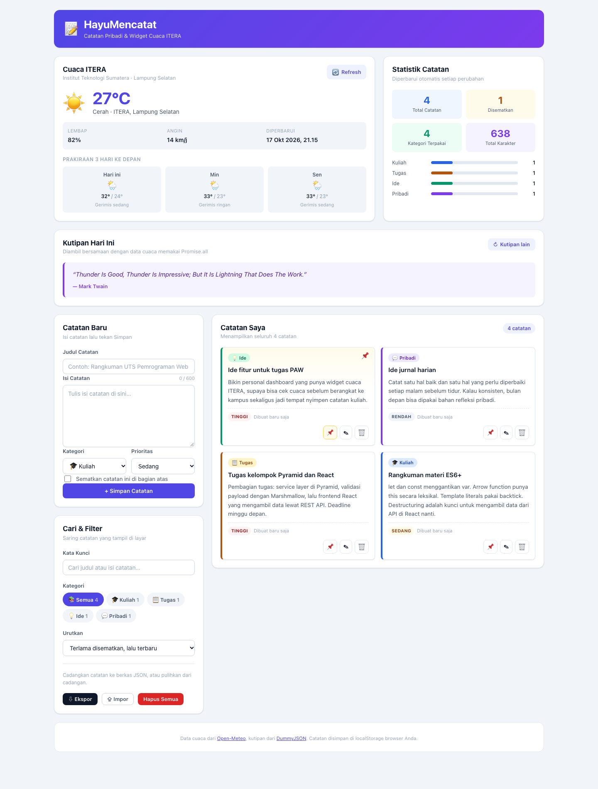
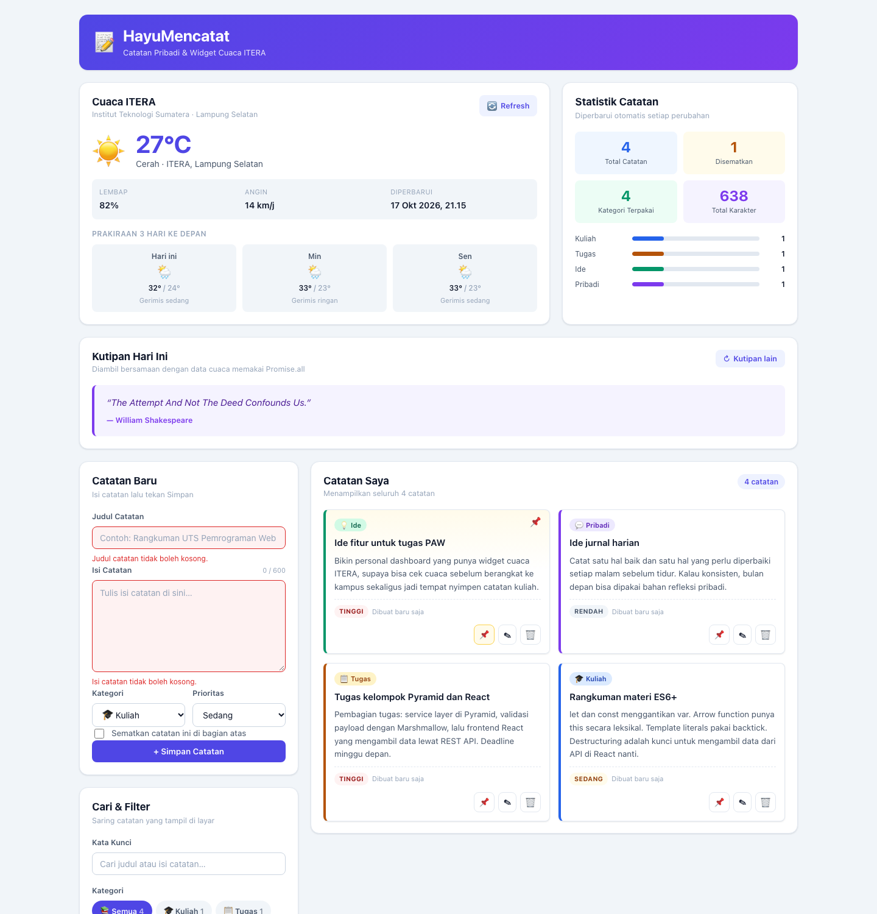
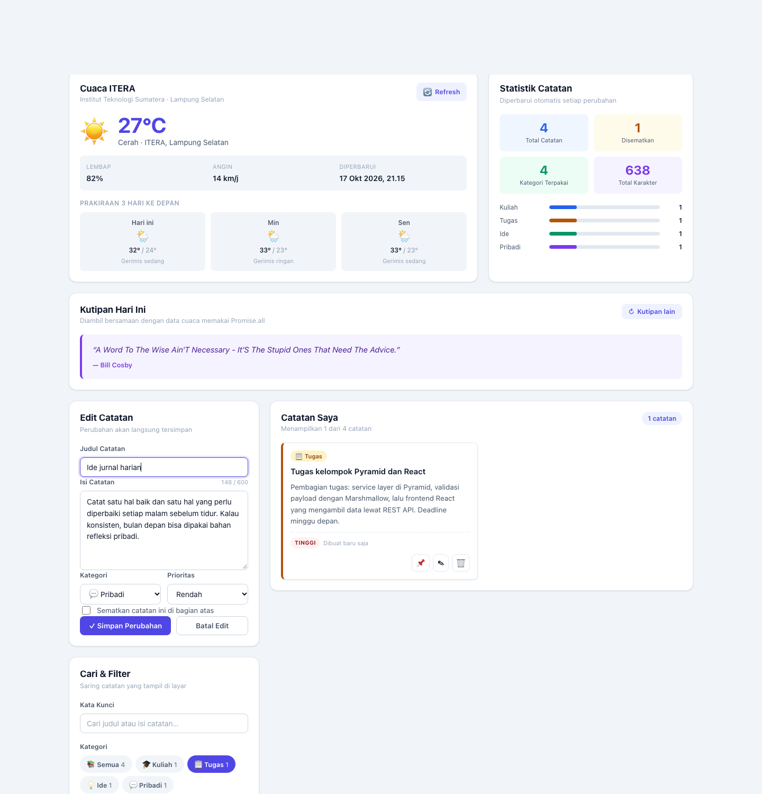
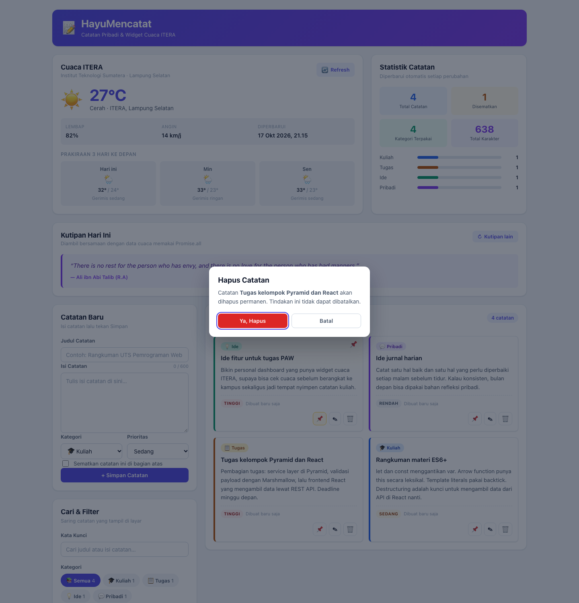
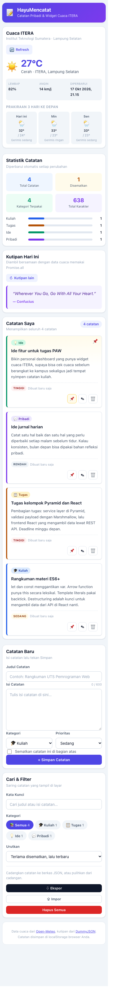
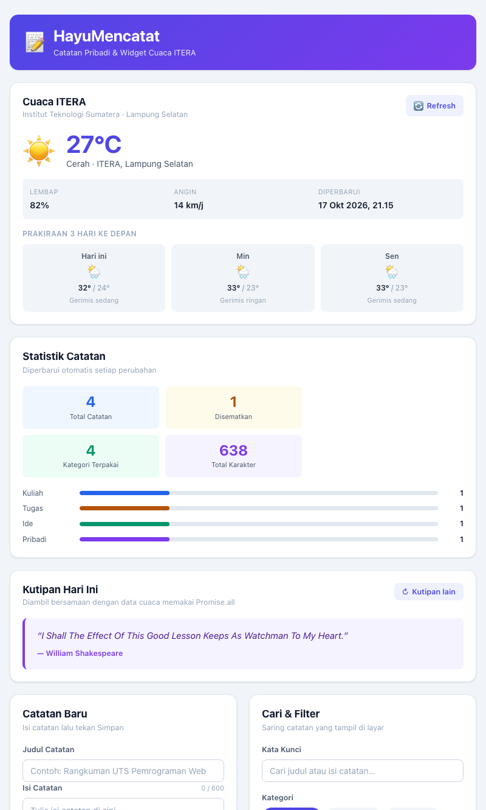

# 🗒️ HayuMencatat — Catatan Pribadi & Widget Cuaca ITERA

**Tugas Praktikum Pengembangan Aplikasi Web — Pertemuan 2: JavaScript Next Gen (ES6+)**


## 📋 Identitas

| | |
|---|---|
| **Nama Lengkap** | Muhammad Faiz Ashfaq |
| **NIM** | 124140144 |
| **Kelas Praktikum** | RA |
| **Pertemuan** | 2 — JavaScript Next Gen (ES6+) |
| **Mata Kuliah** | Praktikum Pengembangan Aplikasi Web |
| **Repository** | `https://github.com/faizashfaq/pemrograman_web_itera_124140144.git` |

---

## 📖 Deskripsi Aplikasi

**HayuMencatat** adalah *personal dashboard* berbasis web yang menggabungkan dua hal yang
justru sering bertentangan: tempat menyimpan catatan pribadi, dan informasi cuaca
real-time di kampus.

Sebagai mahasiswa, salah satu kebiasaan yang sering terjadi adalah mencatat ide
atau tugas yang muncul di tengah jalan, lalu pagi berikutnya lupa. HayuMencatat dibuat
untuk menyelesaikan itu: satu layar depan berisi cuaca ITERA supaya tahu harus
bawa payung atau tidak, kutipan harian sebagai penyemu, dan daftar catatan yang
tersimpan permanen di browser.

Aplikasi ini dibangun murni menggunakan **HTML, CSS, dan JavaScript (ES6+)**
tanpa framework, tanpa *build step*, dan tanpa *library* eksternal. Seluruh data
catatan disimpan di `localStorage` sehingga tetap ada setelah browser ditutup.
Data cuaca diambil langsung dari **Open-Meteo** dan kutipan dari **DummyJSON**,
keduanya API publik gratis tanpa API key.

### Tujuan Pembuatan

1. Menyediakan tempat penyimpanan catatan yang cepat dan tidak perlu koneksi internet.
2. Menampilkan informasi cuaca kampus ITERA secara real-time sebelum berangkat.
3. Mempraktikkan seluruh fitur **ES6+** yang diajarkan pada Pertemuan 2 di dalam
   satu aplikasi yang benar-benar berguna, bukan sekadar latihan terpisah.
4. Menunjukkan pola penulisan kode yang rapi: modular, ber-komentar, dan mudah dibaca.

### Alur Penggunaan

```
Buka aplikasi
     ↓
Cuaca ITERA & kutipan dimuat otomatis (async/await, paralel via Promise.allSettled)
     ↓
Catatan contoh dimuat dari localStorage  →  atau  isi form "Catatan Baru"
     ↓
┌─────────────────────────────────────────────────────────┐
│  Tambah  → isi judul, isi, kategori, prioritas → Simpan   │
│  Edit    → klik ikon pensil pada kartu → ubah → Simpan  │
│  Hapus   → ikon tong sampah → konfirmasi di modal         │
│  Semat   → ikon pin → catatan naik ke posisi teratas      │
│  Cari    → ketik di "Kata Kunci" (dengan debounce)        │
│  Filter  → klik chip kategori atau pilih urutan            │
└─────────────────────────────────────────────────────────┘
     ↓
Setiap perubahan langsung disimpan ke localStorage (JSON)
     ↓
Ekspor / Impor JSON sebagai cadangan
```

---

## 🚀 Panduan Menjalankan

### Cara 1 — Live Server (VS Code, *disarankan*)

1. Buka folder ini di VS Code.
2. Pasang ekstensi **Live Server**.
3. Klik kanan `index.html` → **Open with Live Server**.
4. Browser otomatis terbuka di `http://127.0.0.1:5500`.

> Aplikasi ini memakai `fetch()` untuk mengambil data cuaca. Karena kebijakan
> CORS browser, **file yang dibuka langsung lewat `file://` tidak dapat
> mengambil data cuaca**, meski catatannya sendiri tetap berfungsi. Selalu
> jalankan melalui Live Server atau server lokal.

### Cara 2 — Live Server (XAMPP)

1. Salin folder ini ke `C:\xampp\htdocs\`.
2. Jalankan **Apache** dari XAMPP Control Panel.
3. Buka `http://localhost/muhammadfaizashfaq_124140144_pertemuan2/` di browser.

### Cara 3 — Server Lokal via Terminal

```bash
# Pastikan sudah masuk ke folder ini
python3 -m http.server 8000
# atau, bila memakai Node.js
npx serve .
```

Lalu buka `http://localhost:8000`.

### Cara 4 — Langsung Tanpa Server

Buka `index.html` dengan klik ganda. **Catatan CRUD, filter, dan localStorage
tetap berjalan.** Hanya widget cuaca dan kutipan yang gagal dimuat, dan aplikasi
menampilkan pesan error yang jelas pada masing-masing widget — bukan halaman kosong.

### Menjalankan File Latihan (`modul/`)

Folder `modul/` berisi **jawaban latihan** untuk tiap bagian materi ES6+, bukan
ulangan materi. Isinya hanya soal latihan resmi beserta kode solusinya, sudah
sesuai daftar pada modul di web. Materi tutorial tidak diulang di sini.
Semuanya mandiri dan memakai `modul.css` yang sama.

| File | Latihan yang dijawab | Jumlah |
|---|---|---|
| `modul/02-template-literals.html` | `const`, `var` dalam blok, arrow function, HTML string | 4 |
| `modul/03-destructuring-spread-rest.html` | Nested destructuring, rest parameter, merge spread, `for...of` | 4 |
| `modul/04-classes-dan-object-literals.html` | Inheritance class, getter dan setter, computed property, parameter gabungan | 4 |
| `modul/05-modern-array-methods.html` | `groupBy`, rata-rata, flatten, analisis gabungan | 4 |
| `modul/06-async-programming.html` | Fetch paralel, retry backoff, loading state, error boundary, pagination, debounce | 6 |

Tiap halaman memuat **soal latihan (teks resmi), lalu kode solusi dan hasilnya**,
tanpa materi tutorial. Hasil setiap latihan ditulis ke `<div id="result">` **dan**
ke console browser. Buka console (`Cmd`+`Option`+`I` di macOS, `F12` di Windows)
untuk melihat `console.log` lengkapnya.

> Catatan: halaman `modul/06-async-programming.html` membutuhkan sekitar 5 detik
> untuk seluruh bagian selesai karena beberapa latihan memang memakai jeda
> async dan exponential backoff.

Setiap halaman latihan memuat hasilnya ke `<div id="result">` **dan** ke console
browser. Buka console (`Cmd`+`Option`+`I` di macOS, `F12` di Windows) untuk
melihat `console.log` lengkapnya.

---

## ✅ Daftar Fitur

### 1. CRUD Catatan Lengkap

- **Create** — form tervalidasi (judul wajib ≥ 3 karakter, isi wajib ≥ 5 karakter),
  lengkap dengan penghitung karakter `0 / 600`.
- **Read** — daftar kartu catatan dengan kategori, prioritas, dan waktu relatif
  ("baru saja", "3 jam lalu", "kemarin").
- **Update** — mode edit mengisi form otomatis dengan data lama, menampilkan tombol
  "Batal Edit", dan menandai waktu perubahan pada kartu.
- **Delete** — dialog konfirmasi-modal menampilkan judul catatan yang akan dihapus,
  dengan fokus otomatis ke tombol konfirmasi.
- **Semat** — satu klik untuk menyematkan/melepas catatan; catatan tersemat
  selalu berada di posisi teratas pada semua urutan.

### 2. Pencarian, Filter, dan Pengurutan

- Pencarian judul **dan** isi dengan **debounce 250 ms** agar tidak render tiap ketikan.
- Filter kategori lewat *chip* yang menampilkan jumlah catatan per kategori.
- Empat mode urutan: terlama disematkan lalu terbaru, terlama ke terbaru,
  judul A–Z (`localeCompare("id")`), dan prioritas tertinggi.
- Kondisi kosong dibedakan: *"Belum ada catatan"* vs *"Tidak ada catatan yang cocok"*.

### 3. Widget Cuaca ITERA & Kutipan (Async) 

- Cuaca real-time ITERA (lat `-5.36`, lon `105.31`) dari **Open-Meteo**:
  suhu, kondisi langit, kelembapan, kecepatan angin, waktu pembaruan, dan
  prakiraan **3 hari ke depan** dengan terjemahan 28 kode cuaca WMO ke bahasa Indonesia.
- Kutipan harian dari **DummyJSON**, diambil **secara paralel** bersama data cuaca.
- State *loading*, *success*, dan *error* untuk masing-masing widget secara terpisah,
  memakai `Promise.allSettled` sehingga satu sumber yang gagal **tidak** membuat
  widget lain ikut kosong.
- Batas waktu 8 detik lewat `Promise.race` agar tidak menggantung saat jaringan lambat.
- Tombol muat ulang pada masing-masing widget, dengan status *disabled* saat memuat.

### 4. Manajemen List & LocalStorage

- Kunci `hayumencatat_catatan_124140144`; muatan berbentuk `{ versi, idBerikutnya, catatan }`.
- Semua operasi tulis dibungkus `try/catch` untuk menangani **JSON rusak** dan
  **kuota localStorage penuh**.
- Sanitasi `kategori` dan `prioritas` pada kelas `NoteItem`, sehingga berkas impor
  yang berisi data asing tidak dapat merusak aplikasi.
- **Ekspor** seluruh catatan ke berkas JSON, dan **Impor** untuk memulihkannya
  (validasi struktur, jumlah, dan isi berkas sebelum dipakai).

### 5. Statistik Langsung

Total catatan, jumlah disematkan, jumlah kategori terpakai, total karakter, dan
diagram sebaran kategori — semuanya dihitung ulang otomatis setiap perubahan
dengan `reduce()` dan `filter()`.

### 6. Desain Antarmuka (UI/UX)

- Murni CSS dengan **custom property** (`--warna-utama`, `--radius-kartu`, dst).
- **Responsif penuh** dengan lima titik henti (1280 / 940 / 720 / 640 / 400 px)
  plus satu blok khusus `@media (pointer: coarse)`. Prinsipnya: grid yang isinya
  angka pendek (prakiraan cuaca, detail cuaca, statistik) **tidak pernah**
  runtuh menjadi satu kolom, karena yang diruntuhkan bukan isinya tapi ruang
  kosongnya. Grid yang benar-benar besar (kartu catatan) baru turun ke satu kolom.
- Aksesibilitas: atribut `aria-live` pada area dinamis, `aria-pressed` pada chip
  filter, `aria-busy` pada widget cuaca, `aria-label` pada tombol ikon.
- Notifikasi *toast* untuk setiap aksi berhasil atau gagal.
- Gaya cetak (`@media print`) yang menyembunyikan kontrol dan hanya mencetak isi.
- Penekanan `escapeHtml()` pada **setiap** nilai yang berasal dari pengguna.

### 7. Struktur Kode & Dokumentasi

- Tiga kelas dengan tanggung jawab terpisah: `NoteItem` (model), `CuacaService`
  (API), `DashboardApp` (state & UI).
- Pembaruan state selalu **immutable** dengan spread operator dan modern array methods.
- Berkas `script.js` diberi komentar blok di bagian atas yang menjelaskan alur logika.
- Lima halaman latihan terpisah di `modul/`, masing-masing berisi jawaban
  latihan resmi modul, bukan materi tutorial.

---

## 🖼️ Tangkapan Layar (Screenshot)

### 1. Tampilan Awal — Dashboard Lengkap

Widget cuaca ITERA real-time, statistik, kutipan harian, form catatan, dan
daftar catatan contoh.



### 2. Validasi Error pada Form

Mengirim form kosong akan menandai kolom yang bermasalah dan menampilkan toast
peringatan. Data lama **tidak** hilang.



### 3. Mode Edit dan Filter Kategori

Form berpindah ke mode "Edit Catatan" dan terisi otomatis dengan data lama,
sementara chip filter "Tugas" aktif sehingga daftar di kanan hanya menampilkan
catatan kategori tugas.



### 4. Dialog Konfirmasi Hapus

Klik ikon tong sampah memunculkan modal konfirmasi yang menyebut judul catatan
dan meminta persetujuan eksplisit sebelum dihapus permanen.



### 5. Tampilan Ponsel (390 px)

Semua grid data padat tetap berjajar: tiga hari prakiraan, tiga angka cuaca, dan
empat kotak statistik tidak pernah runtuh menjadi satu kolom. Kartu catatan
disempatkan di atas agar isi utama langsung terlihat.



### 6. Tampilan Tablet (768 px)

Form dan panel filter berdampingan di atas daftar catatan, memakai lebar yang
sisa tablet. Dashboard turun ke satu kolom, namun kotak statistik tetap 2 x 2
dan tidak melebar berlebihan.



---

## 📂 Struktur Folder

```
muhammadfaizashfaq_124140144_pertemuan2/
├── index.html                 # Halaman utama aplikasi
├── style.css                  # Seluruh gaya, custom property + responsif
├── script.js                  # Logika aplikasi: 3 class, CRUD, async
├── README.md                  # Dokumentasi ini
├── .gitignore
│
├── docs/                      # Tangkapan layar untuk laporan
│   ├── 01-tampilan-awal.png
│   ├── 02-validasi-error.png
│   ├── 03-mode-edit-dan-filter.png
│   ├── 04-konfirmasi-hapus.png
│   ├── 05-tampilan-mobile.png
│   └── 06-tampilan-tablet.png
│
└── modul/                     # Jawaban latihan: 5 halaman (mandiri)
    ├── modul.css              # Gaya bersama seluruh halaman latihan
    ├── 02-template-literals.html / .js                      (4 latihan)
    ├── 03-destructuring-spread-rest.html / .js              (4 latihan)
    ├── 04-classes-dan-object-literals.html / .js             (4 latihan)
    ├── 05-modern-array-methods.html / .js                   (4 latihan)
    └── 06-async-programming.html / .js                      (6 latihan)
```

---

## 🧪 Ringkasan Pengujian

| No | Skenario | Hasil |
|---|---|---|
| 1 | Submit form kosong | Dua field ditandai merah, pesan tampil, data lama utuh ✅ |
| 2 | Simpan catatan baru | Kartu muncul, statistik & localStorage ikut ter-update ✅ |
| 3 | Edit catatan | Form terisi otomatis, label "Diubah" muncul, mode kembali ke "Catatan Baru" ✅ |
| 4 | Sempat / lepas catatan | Status pin berubah dan tersimpan ✅ |
| 5 | Cari kata kunci | Debounce bekerja, hanya hasil cocok yang tampil ✅ |
| 6 | Cari tanpa hasil | Empty state "Tidak ada catatan yang cocok" tampil ✅ |
| 7 | Filter kategori | Hanya catatan kategori terpilih yang tampil, chip aktif berubah ✅ |
| 8 | Ubah urutan | A–Z, terlama ke terbaru, dan prioritas terurut benar ✅ |
| 9 | Hapus catatan | Modal konfirmasi muncul, fokus ke tombol, hapus setelah disetujui ✅ |
| 10 | Muat ulang halaman | Seluruh catatan kembali dari localStorage, id tetap unik ✅ |
| 11 | Input HTML berbahaya | `` dan `<script>` **tidak** dieksekusi ✅ |
| 12 | Widget cuaca | Data real-time ITERA termuat, prakiraan 3 hari tampil ✅ |
| 13 | Widget kutipan | Termuat paralel bersama cuaca, bisa diganti ✅ |
| 14 | Console browser | Tidak ada error maupun warning ✅ |
| 15 | Lima halaman modul | Semua ter-render penuh, 22 latihan, 0 error console ✅ |
| 16 | Audit responsif 320–1920 px | 28 kombinasi lebar x mode, 0 masalah ✅ |
| 17 | Tablet 768–940 px | Form tidak lagi melebar 736 px ✅ |
| 18 | Target sentuh (pointer coarse) | Semua kontrol ≥ 40 px ✅ |

---

## 📚 Teknologi yang Digunakan

| Teknologi | Peran |
|---|---|
| **HTML5** | Struktur semantik, atribut `aria-*` untuk aksesibilitas |
| **CSS3** | Custom property, Grid, Flexbox, `clamp`, `@media print` |
| **JavaScript ES6+** | Class, arrow function, template literal, destructuring, spread, async/await |
| **localStorage** | Penyimpanan permanen catatan di sisi klien |
| **Blob & FileReader** | Fitur ekspor dan impor JSON |
| **[Open-Meteo](https://open-meteo.com/)** | Data cuaca real-time — gratis, tanpa API key |
| **[DummyJSON](https://dummyjson.com/)** | Kutipan harian — gratis, tanpa API key |

**Tanpa** framework, tanpa *build step*, tanpa *node_modules*, tanpa dependensi.

---

<div align="center">


</div>
