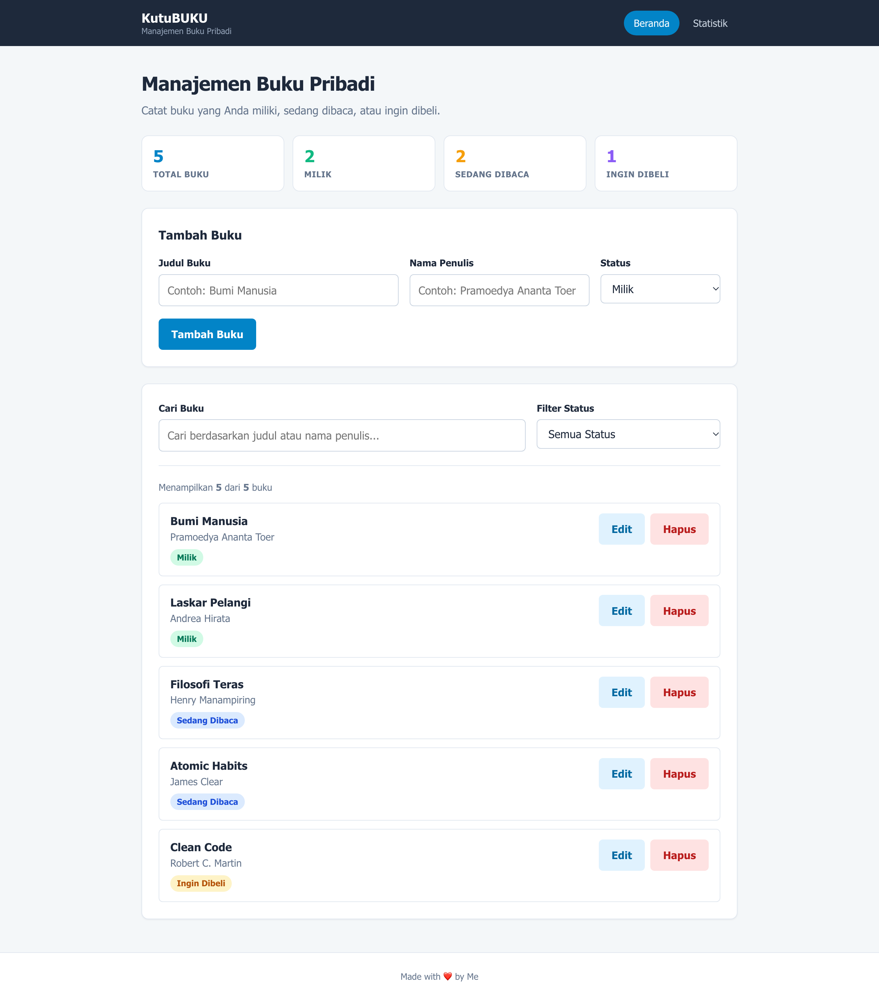
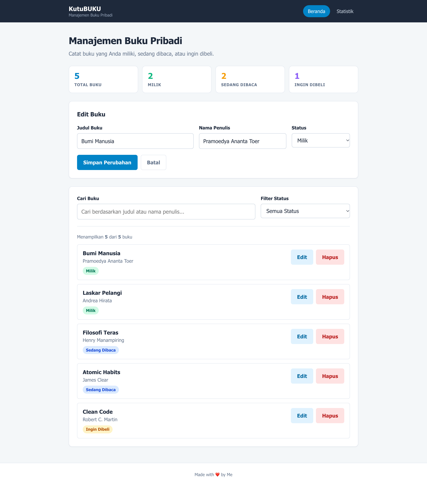
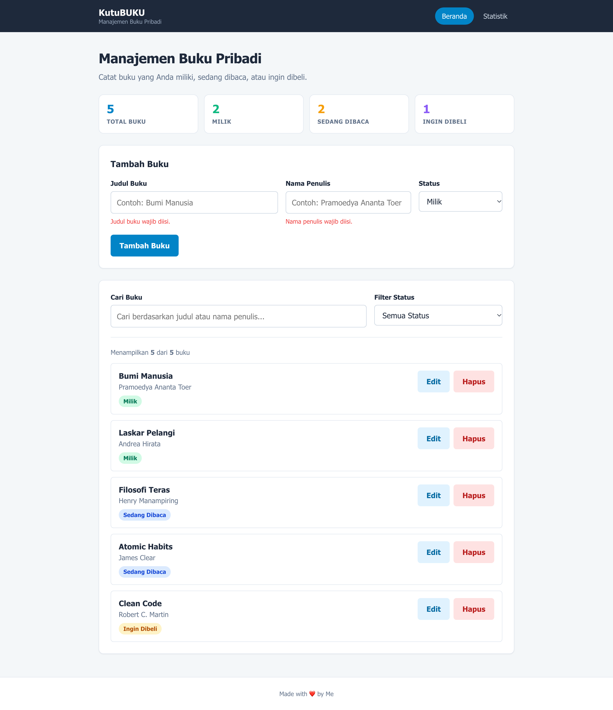
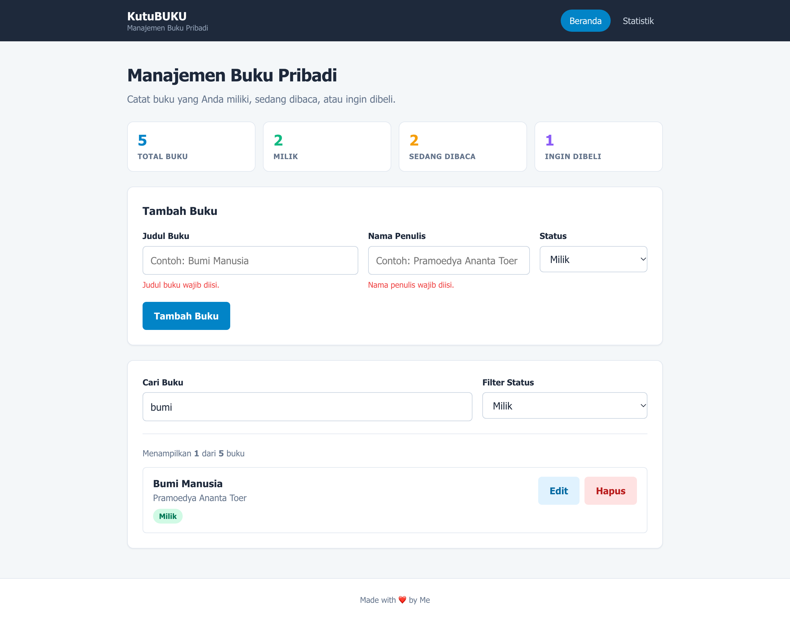
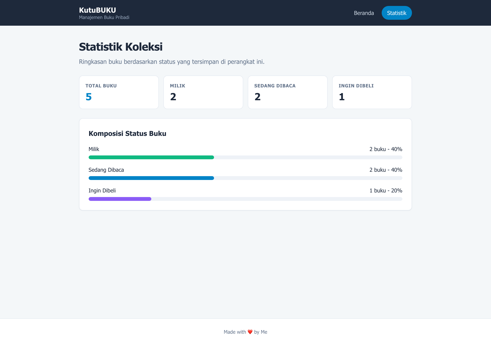
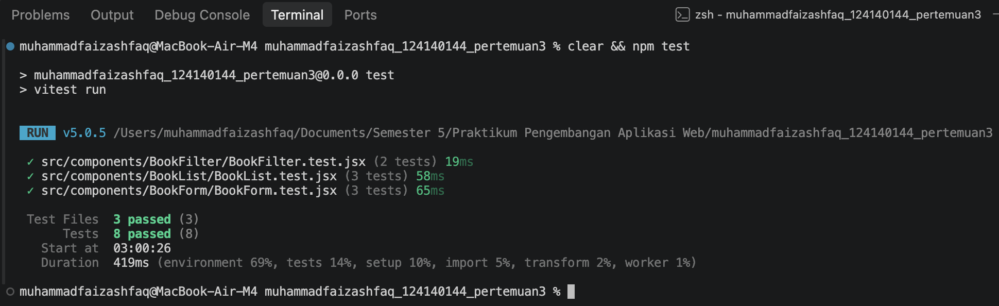

# 📚 KutuBUKU — Aplikasi Manajemen Buku Pribadi

**Tugas Praktikum Pengembangan Aplikasi Web — Pertemuan 3: React Basics**

## 📋 Identitas

| | |
|---|---|
| **Nama Lengkap** | Muhammad Faiz Ashfaq |
| **NIM** | 124140144 |
| **Kelas Praktikum** | RA |
| **Pertemuan** | 3 — React Basics |
| **Mata Kuliah** | Praktikum Pengembangan Aplikasi Web |
| **Repository** | `https://github.com/faizashfaq/pemrograman_web_itera_124140144.git` |

---

## 📖 Deskripsi Aplikasi

**KutuBUKU** adalah aplikasi manajemen buku pribadi yang membantu pengguna mencatat
buku yang sudah dimiliki, sedang dibaca, maupun yang ingin dibeli. Setiap buku
disimpan lengkap dengan judul, nama penulis, dan statusnya, sehingga koleksi bisa
ditelusuri lewat pencarian, filter status, dan halaman statistik.

Aplikasi dibangun menggunakan **React 19 + Vite** dengan *functional components*
dan Hooks. Seluruh data buku dikelola secara global melalui **Context API** dan
disimpan otomatis di `localStorage`, sehingga koleksi tetap ada setelah browser
ditutup. Navigasi antarhalaman menggunakan **React Router** tanpa memuat ulang
dokumen.

### Alur Penggunaan

```
Buka aplikasi di browser
  ↓
Data buku dimuat dari localStorage (useLocalStorage)
  ↓
┌──────────────────────────────────────────────────────────────┐
│ Tambah  → isi judul, penulis, status → tombol "Tambah Buku"  │
│ Edit    → tombol "Edit" pada kartu buku → ubah → Simpan      │
│ Hapus   → tombol "Hapus" pada kartu buku                     │
│ Cari    → ketik judul atau nama penulis di kolom pencarian   │
│ Filter  → pilih status: semua / milik / baca / beli          │
│ Statistik → menu "Statistik" untuk ringkasan koleksi         │
└──────────────────────────────────────────────────────────────┘
  ↓
Setiap perubahan langsung disimpan ke localStorage (key "books_data")
```

### Status Buku

| Nilai | Label | Arti |
|---|---|---|
| `milik` | Milik | Buku sudah ada di rak dan dimiliki |
| `baca` | Sedang Dibaca | Buku yang sedang dibaca |
| `beli` | Ingin Dibeli | Buku yang masuk daftar keinginan |

---

## ✨ Fitur

| Fitur | Keterangan |
|---|---|
| **Tambah buku** | Form dengan kolom judul, penulis, dan status |
| **Edit buku** | Form terisi otomatis saat tombol Edit ditekan, lengkap dengan tombol Batal |
| **Hapus buku** | Menghapus buku dari daftar dan dari `localStorage` |
| **Filter status** | Menampilkan buku berdasarkan status tertentu atau seluruhnya |
| **Pencarian** | Mencari berdasarkan judul **atau** nama penulis (tidak peka huruf besar/kecil) |
| **Statistik** | Halaman ringkasan jumlah dan komposisi status buku |
| **Validasi form** | Kolom judul dan penulis wajib diisi, dengan border merah dan pesan error |
| **Penyimpanan permanen** | Data tersimpan di `localStorage` dan bertahan setelah halaman dimuat ulang |

---

## 🖼️ Screenshot Antarmuka

### Halaman Beranda



### Mode Edit Buku



### Validasi Form



### Pencarian dan Filter Status



### Halaman Statistik



---

## 🧩 Latihan Mandiri (modul/)

Jawaban latihan mandiri dari setiap submodul disimpan terpisah di folder `modul/`.
Tiap folder berisi satu `index.html` mandiri yang memuat React 18 dan Babel
Standalone dari CDN, sehingga bisa dibuka langsung di browser tanpa `npm install`.

| Folder | Latihan | Ringkasan |
|---|---|---|
| `modul/01-eksplorasi-hmr/` | Submodul 1 | Header berwarna `#0d9488` serta tombol pembanding warna awal `#3498db` |
| `modul/02-children-props/` | Submodul 2 | Komponen `Card` dengan `props.children` membungkus `TaskForm` |
| `modul/03-hapus-semua-tugas/` | Submodul 3 | Tombol **Hapus Semua Tugas** dengan konfirmasi `window.confirm()` |
| `modul/04-halaman-404/` | Submodul 4 | Rute penangkap `path="*"` yang menampilkan halaman 404 |
| `modul/05-usewindowsize/` | Submodul 5 | Badge "Mode Layar Mobile" / "Mode Layar Desktop" dari `useWindowSize` |
| `modul/06-statistik-about/` | Submodul 6 | Halaman About membaca `stats.total` dari Context API |

Petunjuk lengkap tiap latihan ada di [`modul/README.md`](modul/README.md).

---

## 🚀 Panduan Instalasi dan Menjalankan

### Prasyarat

- **Node.js** versi `20.19+` atau `22.12+` (dibutuhkan oleh Vite 8)
- **npm** (terpasang bersama Node.js)
- **VS Code** beserta terminal terintegrasi

### Langkah Menjalankan

```bash
# 1. Masuk ke folder project tugas
cd muhammadfaizashfaq_124140144_pertemuan3/tugas-manajemen-buku

# 2. Pasang seluruh dependensi
npm install

# 3. Jalankan development server
npm run dev
```

Buka alamat yang muncul di terminal, biasanya **http://localhost:5173**.

### Perintah Lain

Seluruh perintah berikut dijalankan di dalam folder `tugas-manajemen-buku/`.

| Perintah | Fungsi |
|---|---|
| `npm run dev` | Menjalankan development server dengan Hot Module Replacement |
| `npm test` | Menjalankan seluruh unit test sekali jalan (`vitest run`) |
| `npx vitest` | Menjalankan test dalam mode watch |
| `npm run lint` | Memeriksa kualitas kode dengan oxlint |
| `npm run build` | Membuat bundle produksi ke folder `dist/` |
| `npm run preview` | Melihat hasil build produksi secara lokal |

---

## 🗂️ Struktur Folder

```
muhammadfaizashfaq_124140144_pertemuan3/
├── dokumentasi/                   # Screenshot untuk dokumentasi
│   ├── beranda.png
│   ├── edit-buku.png
│   ├── validasi.png
│   ├── pencarian-filter.png
│   ├── statistik.png
│   └── hasil-test.png
├── tugas-manajemen-buku/          # Project React (tugas utama)
│   ├── public/
│   │   └── favicon.svg
│   ├── src/
│   │   ├── components/
│   │   │   ├── BookFilter/        # Pencarian + filter status
│   │   │   │   ├── BookFilter.jsx
│   │   │   │   ├── BookFilter.css
│   │   │   │   └── BookFilter.test.jsx
│   │   │   ├── BookForm/          # Form tambah dan edit buku
│   │   │   │   ├── BookForm.jsx
│   │   │   │   ├── BookForm.css
│   │   │   │   └── BookForm.test.jsx
│   │   │   └── BookList/          # Daftar buku + tombol edit/hapus
│   │   │       ├── BookList.jsx
│   │   │       ├── BookList.css
│   │   │       └── BookList.test.jsx
│   │   ├── context/
│   │   │   └── BookContext.jsx    # State global buku (Provider + useBooks)
│   │   ├── hooks/
│   │   │   ├── useLocalStorage.js # Custom hook sinkronisasi localStorage
│   │   │   └── useBookStats.js    # Custom hook perhitungan statistik
│   │   ├── pages/
│   │   │   ├── Home/
│   │   │   │   ├── Home.jsx
│   │   │   │   └── Home.css
│   │   │   └── Stats/
│   │   │       ├── Stats.jsx
│   │   │       └── Stats.css
│   │   ├── App.jsx                # Router + Provider + layout
│   │   ├── App.css
│   │   ├── index.css              # Variabel warna dan style dasar
│   │   ├── main.jsx
│   │   └── setupTests.js          # Konfigurasi jest-dom untuk Vitest
│   ├── index.html
│   ├── package.json
│   └── vite.config.js             # Konfigurasi Vite + Vitest
├── modul/                         # Jawaban latihan mandiri tiap submodul
│   ├── 01-eksplorasi-hmr/
│   ├── 02-children-props/
│   ├── 03-hapus-semua-tugas/
│   ├── 04-halaman-404/
│   ├── 05-usewindowsize/
│   ├── 06-statistik-about/
│   └── README.md                  # Daftar dan cara membuka latihan
└── README.md
```

---

## ⚛️ Penjelasan Fitur React yang Digunakan

Seluruh path file pada bagian ini relatif terhadap folder `tugas-manajemen-buku/`.

### 1. Functional Components dan JSX

Seluruh antarmuka dibangun dari *functional components* yang mengembalikan JSX.
Tidak ada class component di dalam project ini.

### 2. Props dan PropTypes

Data dan *callback* dikirim dari parent ke child melalui props, misalnya
`BookList` menerima `books`, `onEdit`, dan `onDelete` dari `Home`. Setiap komponen
yang menerima props dilengkapi `PropTypes` untuk memvalidasi tipe data saat
pengembangan.

```jsx
BookList.propTypes = {
  books: PropTypes.arrayOf(
    PropTypes.shape({
      id: PropTypes.number.isRequired,
      title: PropTypes.string.isRequired,
      author: PropTypes.string.isRequired,
      status: PropTypes.oneOf(['milik', 'baca', 'beli']).isRequired,
    })
  ).isRequired,
  onEdit: PropTypes.func.isRequired,
  onDelete: PropTypes.func.isRequired,
};
```

### 3. useState

State lokal dipakai untuk data yang hanya dibutuhkan satu komponen:

- `BookForm` → menyimpan isi form (`form`) dan pesan error (`errors`).
- `Home` → menyimpan kata kunci pencarian, filter status, dan buku yang sedang diedit.
- `BookFilter` → tidak menyimpan state sendiri; nilainya dikendalikan parent
  (*controlled component*).

### 4. useEffect

`useEffect` dipakai di dalam custom hook `useLocalStorage`:

```js
useEffect(() => {
  try {
    window.localStorage.setItem(key, JSON.stringify(storedValue));
  } catch (error) {
    console.error(`Gagal menyimpan localStorage key "${key}":`, error);
  }
}, [key, storedValue]);
```

Efek ini berjalan setiap kali daftar buku berubah, sehingga data selalu
tersimpan tanpa perlu tombol "Simpan" khusus.

### 5. Conditional Rendering

- `BookList` menampilkan pesan kosong apabila `books.length === 0`.
- `Stats` menampilkan pesan khusus bila belum ada buku sama sekali.
- Label tombol form berubah sesuai mode: `Tambah Buku` atau `Simpan Perubahan`.
- Tombol `Batal` hanya muncul pada mode edit.

### 6. Rendering List dan Key

Daftar buku di-render dengan `books.map()` menggunakan `key={book.id}` agar React
dapat mengoptimalkan proses rekonsiliasi DOM.

### 7. Controlled Component dan Event Handling

Semua input dikendalikan state React: nilai `value` berasal dari state dan setiap
perubahan ditangani `onChange`. `BookForm` juga menangani `onSubmit` untuk
mencegah perilaku bawaan form dengan `event.preventDefault()`.

### 8. React Router

`App.jsx` membungkus aplikasi dengan `BrowserRouter` dan mendefinisikan dua rute:

```jsx
<Routes>
  <Route path="/" element={<Home />} />
  <Route path="/statistik" element={<Stats />} />
</Routes>
```

Navigasi memakai `NavLink` sehingga tautan aktif otomatis diberi gaya berbeda dan
perpindahan halaman terjadi tanpa *reload*.

### 9. Context API

`BookContext.jsx` menyediakan `BookProvider` yang menampung state `books` beserta
fungsi `addBook`, `updateBook`, dan `deleteBook`. Komponen mana pun memakai hook
`useBooks()` untuk mengaksesnya, sehingga tidak ada *prop drilling* dari `App`
ke `Home` ke `BookList`.

```jsx
export function useBooks() {
  const context = useContext(BookContext);
  if (!context) {
    throw new Error('useBooks harus digunakan di dalam BookProvider');
  }
  return context;
}
```

### 10. Custom Hooks

| Hook | Fungsi |
|---|---|
| `useLocalStorage(key, initialValue)` | Menggabungkan `useState` dan `useEffect` untuk membaca/menulis `localStorage` secara otomatis |
| `useBookStats(books)` | Menghitung total buku, jumlah per status, dan persentasenya |

`useBookStats` dipakai di dua tempat sekaligus (Beranda dan Statistik) sebagai
bukti bahwa logika dapat digunakan ulang.

### 11. Error Handling pada Form

Validasi dilakukan saat submit. Kolom yang kosong diberi class `input-error`
(border merah), atribut `aria-invalid`, dan pesan error di bawah kolom. Pesan
otomatis hilang ketika pengguna mulai mengetik pada kolom tersebut.

---

## 🧪 Laporan Testing

Pengujian unit menggunakan **Vitest + React Testing Library** dengan environment
`jsdom`. Konfigurasi berada di `vite.config.js`, sedangkan matcher `jest-dom`
dimuat melalui `src/setupTests.js`.

### Hasil Eksekusi `npm test`



```text
 RUN  v5.0.5 .../muhammadfaizashfaq_124140144_pertemuan3

 ✓ src/components/BookFilter/BookFilter.test.jsx (2 tests) 20ms
 ✓ src/components/BookList/BookList.test.jsx (3 tests) 65ms
 ✓ src/components/BookForm/BookForm.test.jsx (3 tests) 70ms

 Test Files  3 passed (3)
      Tests  8 passed (8)
```

### Rincian Test

| No | File | Skenario yang diuji |
|---|---|---|
| 1 | `BookForm.test.jsx` | Menampilkan pesan error saat form dikirim kosong dan tidak memanggil `onSave` |
| 2 | `BookForm.test.jsx` | Memanggil `onSave` dengan data yang sudah di-trim saat form valid |
| 3 | `BookForm.test.jsx` | Mengisi form dan menampilkan tombol "Simpan Perubahan" pada mode edit |
| 4 | `BookList.test.jsx` | Merender judul, penulis, dan status setiap buku |
| 5 | `BookList.test.jsx` | Memanggil `onDelete` dengan id buku yang benar |
| 6 | `BookList.test.jsx` | Memanggil `onEdit` dengan objek buku yang benar |
| 7 | `BookFilter.test.jsx` | Memanggil `onSearchChange` saat pengguna mengetik kata kunci |
| 8 | `BookFilter.test.jsx` | Memanggil `onStatusChange` saat filter status diganti |

Jumlah ini melebihi ketentuan minimal **5 test unit**.

---

## ✅ Pemenuhan Ketentuan Tugas

| Ketentuan | Status | Bukti Implementasi |
|---|---|---|
| Menambah buku (judul, penulis, status) | ✅ | `BookForm.jsx`, `addBook` pada `BookContext.jsx` |
| Mengedit dan menghapus buku | ✅ | `updateBook` & `deleteBook`, tombol Edit/Hapus di `BookList.jsx` |
| Filter buku berdasarkan status | ✅ | `BookFilter.jsx` + logika filter di `Home.jsx` |
| Pencarian judul atau penulis | ✅ | Input pencarian di `BookFilter.jsx`, pencocokan di `Home.jsx` |
| Menggunakan `useState` dan `useEffect` | ✅ | `Home.jsx`, `BookForm.jsx`, `useLocalStorage.js` |
| Minimal 3 komponen reusable | ✅ | `BookForm`, `BookList`, `BookFilter` |
| Context API untuk state management | ✅ | `BookContext.jsx` + `useBooks()` |
| React Router untuk navigasi multi-halaman | ✅ | `App.jsx` (Beranda & Statistik) |
| `localStorage` untuk penyimpanan persisten | ✅ | `useLocalStorage('books_data', [])` |
| Minimal 2 custom hooks | ✅ | `useLocalStorage.js`, `useBookStats.js` |
| PropTypes pada seluruh komponen | ✅ | `BookForm`, `BookList`, `BookFilter`, `BookProvider` |
| Minimal 5 unit test RTL | ✅ | 8 test di 3 file (lihat laporan testing) |
| Error handling form input | ✅ | Validasi wajib isi + border merah + pesan error |
| README berisi dokumentasi lengkap | ✅ | Dokumen ini |
| Komentar pada bagian penting kode | ✅ | Komentar pada context, hooks, dan komponen |
| Screenshot hasil eksekusi test | ✅ | `dokumentasi/hasil-test.png` |

---

## 📝 Catatan Implementasi

1. **Form tunggal untuk tambah dan edit.** `BookForm` menerima props
   `editingBook`. Di `Home`, komponen ini diberi `key` berdasarkan buku yang
   sedang diedit sehingga form otomatis di-*mount* ulang saat beralih mode. Pola
   ini menghindari `useEffect` yang hanya bertugas menyalin props ke state.
2. **Default parameter, bukan `defaultProps`.** React 19 sudah menghapus dukungan
   `defaultProps` pada functional component, sehingga nilai bawaan ditulis
   langsung di parameter fungsi (`editingBook = null`).
3. **Satu sumber kebenaran.** `books` hanya disimpan di `BookContext`; `Home` dan
   `Stats` membaca data melalui `useBooks()` agar tampilan selalu konsisten.

---

## 🔗 Referensi

Modul praktikum: **https://praktikum-paw20262027.vercel.app/pertemuan/3**
