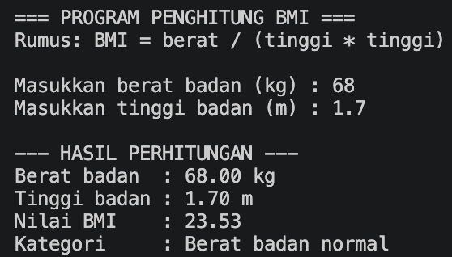
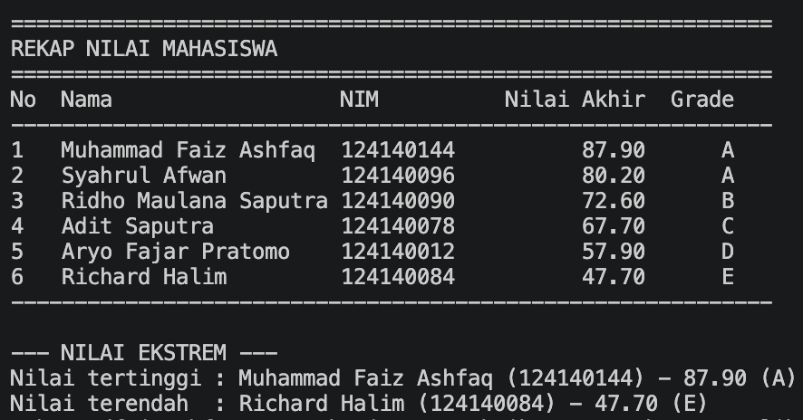
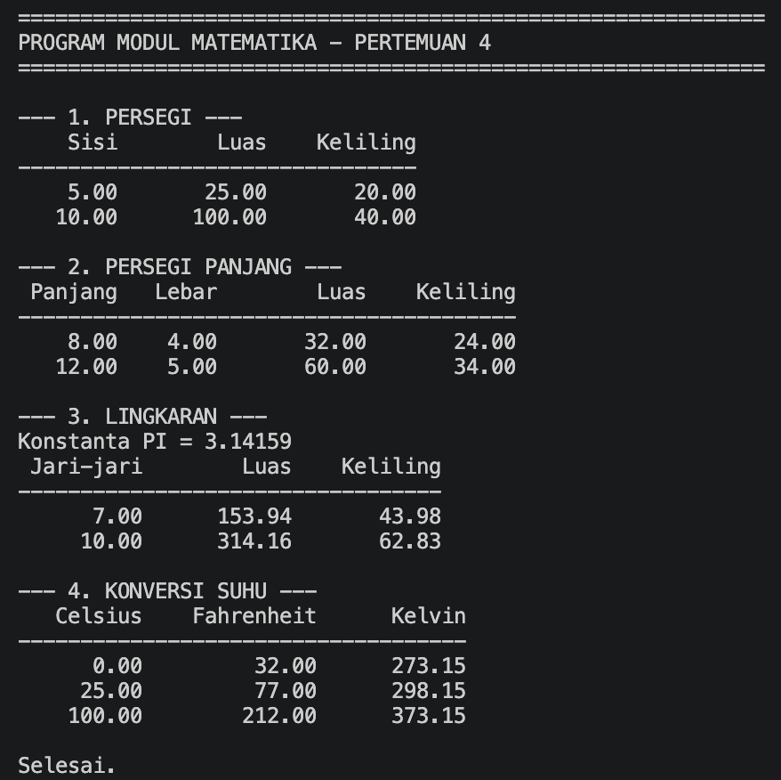

# Python Dasar — Tugas & Latihan Pertemuan 4

**Tugas Praktikum Pengembangan Aplikasi Web — Pertemuan 4: Python Dasar**
Program Studi Teknik Informatika · ITERA · T.A. 2026/2027 Gasal

---

## 📋 Identitas

| | |
|---|---|
| **Nama Lengkap** | Muhammad Faiz Ashfaq |
| **NIM** | 124140144 |
| **Kelas Praktikum** | RA |
| **Pertemuan** | 4 — Python Dasar |
| **Mata Kuliah** | Praktikum Pengembangan Aplikasi Web |
| **Repository** | `pemrograman_web_itera_124140144` |

---

## 📖 Deskripsi

Folder ini memuat **tiga program tugas** (bobot total 100%) dan **enam latihan mandiri**
dari Pertemuan 4: **Python Dasar**. Seluruh berkas ditulis dengan **Python murni tanpa
dependensi eksternal**, sehingga bisa langsung dijalankan lewat terminal VS Code.

Penekanan utama pengerjaan: setiap berkas hanya memakai konsep yang memang sudah
diajarkan pada modul — variabel & tipe data, operator, struktur kendali (`if`/loop),
fungsi, struktur data (`list`, `tuple`, `dictionary`, `set`), serta modul & package.
Tidak ada `try/except`, class, atau library pihak ketiga karena belum masuk materi.

### Daftar Tugas

| Soal | Berkas | Bobot | Ringkasan |
|---|---|---|---|
| **1** | `tugas1_bmi.py` | 30% | Menghitung BMI dan menentukan kategori berat badan |
| **2** | `tugas2_nilai_mahasiswa.py` | 40% | Mengelola nilai mahasiswa, grade A–E, tabel, dan nilai ekstrem |
| **3** | `math_operations.py` + `main.py` | 30% | Modul matematika (geometri & suhu) dan program pengujinya |

---

## 🗂️ Struktur Folder

```text
muhammadfaizashfaq_124140144_pertemuan4/
├── .gitignore                      
├── README.md
├── tugas1_bmi.py                   
├── tugas2_nilai_mahasiswa.py       
├── math_operations.py              
├── main.py                         
├── dokumentasi/                    
│   ├── tugas1-bmi.png
│   ├── tugas2-nilai-mahasiswa.png
│   └── tugas3-math-operations.png
└── latihan/                        
    ├── latihan1.py
    ├── latihan2_suhu.py
    ├── latihan3_tebak.py
    ├── latihan4_validasi.py
    ├── latihan5_kontak.py
    ├── password_gen.py
    └── main.py
```

---

## 1️⃣ Tugas 1 — Program Penghitung BMI

**Berkas:** `tugas1_bmi.py`

Program meminta berat badan (kg) dan tinggi badan (m), menghitung Body Mass Index,
lalu menampilkan kategorinya.

```
Berat badan (kg)  →  input pengguna
Tinggi badan (m)  →  input pengguna
        ↓
BMI = berat / (tinggi × tinggi)
        ↓
if-elif-else menentukan kategori
        ↓
Tampilkan BMI (2 desimal) + kategori
```

| Nilai BMI | Kategori |
|---|---|
| BMI < 18.5 | Berat badan kurang |
| 18.5 ≤ BMI < 25 | Berat badan normal |
| 25 ≤ BMI < 30 | Berat badan berlebih |
| BMI ≥ 30 | Obesitas |

### Contoh Output



---

## 2️⃣ Tugas 2 — Pengelolaan Data Nilai Mahasiswa

**Berkas:** `tugas2_nilai_mahasiswa.py`

Program menyimpan **list berisi 6 dictionary** mahasiswa (kunci `nama`, `nim`,
`nilai_uts`, `nilai_uas`, `nilai_tugas`), menghitung nilai akhir, menentukan grade,
mencetak tabel, lalu mencari nilai tertinggi dan terendah.

```
Nilai Akhir = (30% × UTS) + (40% × UAS) + (30% × Tugas)
```

| Nilai Akhir | Grade |
|---|---|
| ≥ 80 | A |
| 70 – 79 | B |
| 60 – 69 | C |
| 50 – 59 | D |
| < 50 | E |

Data mahasiswa sengaja dibuat mencakup **kelima grade A–E** agar percabangan teruji.

### Contoh Output



---

## 3️⃣ Tugas 3 — Modul Matematika Python

**Berkas:** `math_operations.py` (modul) dan `main.py` (program utama)

### `math_operations.py`

Modul kustom berisi konstanta dan fungsi geometri serta konversi suhu. Setiap fungsi
dilengkapi *docstring*, dan ada blok `if __name__ == "__main__":` untuk menguji modul
secara mandiri.

| Konstanta | `PI = 3.14159` |
|---|---|

| Bentuk / Konversi | Fungsi |
|---|---|
| Persegi | `luas_persegi()`, `keliling_persegi()` |
| Persegi panjang | `luas_persegi_panjang()`, `keliling_persegi_panjang()` |
| Lingkaran | `luas_lingkaran()`, `keliling_lingkaran()` |
| Suhu | `celsius_ke_fahrenheit()`, `celsius_ke_kelvin()` |

### `main.py`

Program utama memakai **seluruh fungsi** modul dengan beberapa nilai uji dan
menerapkan **dua cara import** sekaligus:

```python
# Cara 1: mengimpor seluruh modul
import math_operations

# Cara 2: mengimpor fungsi tertentu langsung ke namespace
from math_operations import celsius_ke_fahrenheit, celsius_ke_kelvin
```
### Contoh Output



---

## 🧩 Latihan Mandiri (`latihan/`)

Jawaban enam latihan mandiri dari setiap submodul disimpan di folder `latihan/`.

| # | Berkas | Materi | Ringkasan |
|---|---|---|---|
| 1 | `latihan1.py` | Pengenalan & Eksekusi | Profil diri, `sep=" \| "`, kartu berbingkai `#`, escape character |
| 2 | `latihan2_suhu.py` | Variabel & Tipe Data | Konversi Celsius → Fahrenheit & Kelvin |
| 3 | `latihan3_tebak.py` | Struktur Kendali | Game tebak angka rahasia dengan `while` + `break` |
| 4 | `latihan4_validasi.py` | Modularitas Fungsi | `validasi_password()` (min. 8 karakter + 1 angka) |
| 5 | `latihan5_kontak.py` | Struktur Data | Katalog kontak dictionary dengan `.get()` |
| 6 | `password_gen.py` + `main.py` | Modul & Package | Modul `buat_password_acak()` beserta pengujinya |

---

## 🚀 Cara Menjalankan

### Prasyarat

- **Python 3.8+** (disarankan 3.10 atau lebih baru) — cek dengan `python3 --version`
- **VS Code** beserta terminal terintegrasi (opsional)

### Langkah Menjalankan

Masuk ke folder pertemuan 4 terlebih dahulu:

```bash
cd muhammadfaizashfaq_124140144_pertemuan4
```

| Perintah | Menjalankan |
|---|---|
| `python3 tugas1_bmi.py` | Tugas 1 (interaktif — input berat & tinggi) |
| `python3 tugas2_nilai_mahasiswa.py` | Tugas 2 (langsung menampilkan tabel) |
| `python3 math_operations.py` | Uji mandiri modul matematika |
| `python3 main.py` | Program utama Tugas 3 |
| `python3 latihan/latihan1.py` | Latihan 1 |
| `python3 latihan/latihan2_suhu.py` | Latihan 2 (interaktif) |
| `python3 latihan/latihan3_tebak.py` | Latihan 3 (interaktif) |
| `python3 latihan/latihan4_validasi.py` | Latihan 4 |
| `python3 latihan/latihan5_kontak.py` | Latihan 5 (menu interaktif) |
| `python3 latihan/main.py` | Latihan 6 (penguji modul password) |

> Di Windows, gunakan `python` sebagai ganti `python3`.

---

## ✅ Kesesuaian Materi

Setiap berkas hanya memakai konsep yang sudah diajarkan sampai materinya:

| Berkas | Materi | Konsep utama |
|---|---|---|
| `latihan1.py` | 1 | `print()`, `sep`, escape character |
| `latihan2_suhu.py` | 1–2 | variabel, `float(input())`, operator, f-string |
| `latihan3_tebak.py` | 1–3 | `while`, `if-elif-else`, `break` |
| `latihan4_validasi.py` | 1–4 | fungsi, docstring, `for`, `in`, `len()` |
| `latihan5_kontak.py` | 1–5 | dictionary, `.get()`, `.items()`, fungsi |
| `password_gen.py` + `main.py` | 1–6 | modul, `random`, `string`, `if __name__ == "__main__"` |
| `tugas1_bmi.py` | 1–3 | variabel, `float(input())`, `if-elif-else`, f-string |
| `tugas2_nilai_mahasiswa.py` | 1–5 | list & dictionary, `for`/`enumerate`, fungsi |
| `math_operations.py` | 1–6 | fungsi, `return`, konstanta, modul |
| `main.py` | 1–6 | dua cara `import`, perulangan, f-string |

---

## 🛠️ Teknologi

| Teknologi | Peran |
|---|---|
| **Python 3** | Bahasa pemrograman seluruh tugas dan latihan |
| **VS Code** | Editor dan terminal terintegrasi |
| **Git** | Kontrol versi dan pengumpulan tugas |

---


