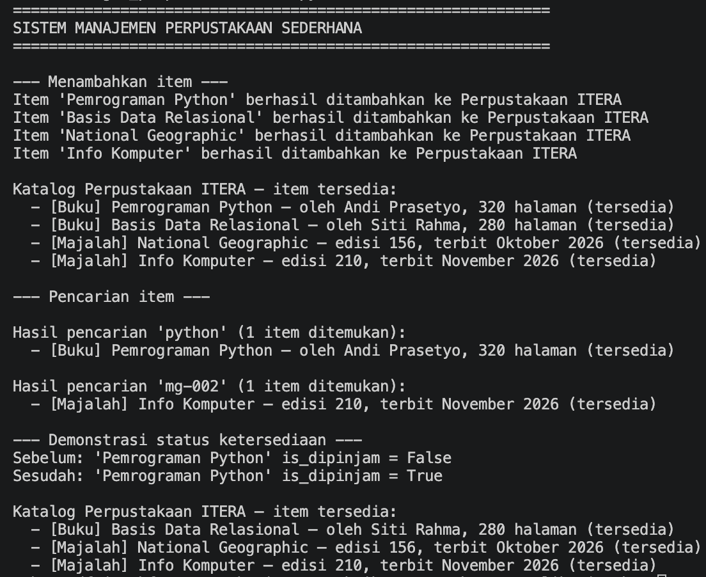

# Python OOP — Tugas & Latihan Pertemuan 5

**Tugas Praktikum Pengembangan Aplikasi Web — Pertemuan 5: Python OOP**
Program Studi Teknik Informatika · ITERA · T.A. 2026/2027 Gasal

---

## 📋 Identitas

| | |
|---|---|
| **Nama Lengkap** | Muhammad Faiz Ashfaq |
| **NIM** | 124140144 |
| **Kelas Praktikum** | RA |
| **Pertemuan** | 5 — Python OOP |
| **Mata Kuliah** | Praktikum Pengembangan Aplikasi Web |
| **Repository** | `pemrograman_web_itera_124140144` |

---

## 📖 Deskripsi

Folder ini memuat **enam latihan mandiri** (satu per materi) dan **tugas praktikum
Sistem Manajemen Perpustakaan Sederhana** dari Pertemuan 5: **Python OOP**.
Seluruh berkas ditulis dengan **Python murni tanpa dependensi eksternal**.

Penekanan utama pengerjaan: setiap berkas hanya memakai konsep yang memang sudah
diajarkan pada modul dan sesuai instruksi latihan mandiri masing-masing bagian —
tidak ada yang ditambah atau dikurangi.

### Daftar Latihan Mandiri

| Materi | Berkas | Ringkasan |
|---|---|---|
| **1 — Pengenalan OOP** | `latihan/latihan_mandiri_01_toko_online.py` | Pemodelan entitas sistem kasir toko (Produk, Keranjang, Pengguna) dalam komentar kode |
| **2 — Class & Object** | `latihan/latihan_mandiri_02_buku.py` | Class `Buku` dengan `hitung_harga_diskon()`, `__str__`, dan `__len__` |
| **3 — Inheritance** | `latihan/latihan_mandiri_03_truk.py` | Subclass `Truk(Kendaraan)` dengan `muat_barang()` tervalidasi dan override `deskripsi()` |
| **4 — Encapsulation** | `latihan/latihan_mandiri_04_karyawan.py` | Class `Karyawan` dengan `__gaji_pokok` private, setter validasi UMR, dan `hitung_gaji_bersih()` |
| **5 — Polymorphism** | `latihan/latihan_mandiri_05_notifikasi.py` | Tiga class notifikasi (`kirim()`) + `broadcast_pengumuman()` tanpa if-elif |
| **6 — Abstract Class** | `latihan/latihan_mandiri_06_filestorage.py` | Abstract class `FileStorage(ABC)` + implementasi `LocalDiskStorage` dan `CloudStorage` |

### Tugas Praktikum: Sistem Manajemen Perpustakaan Sederhana

Program perpustakaan yang menyimpan dan mengelola koleksi buku serta majalah:
menambah item, menampilkan katalog item tersedia, mencari item berdasarkan
judul atau id, dan mendemonstrasikan status ketersediaan item.

| Berkas | Isi |
|---|---|
| `tugas_perpustakaan/library_item.py` | Abstract class `LibraryItem(ABC)` + subclass `Book` & `Magazine` |
| `tugas_perpustakaan/member.py` | Class `Member` untuk identitas anggota perpustakaan |
| `tugas_perpustakaan/library.py` | Class `Library` dengan atribut private `__koleksi` |
| `tugas_perpustakaan/main.py` | Skrip uji lengkap seluruh fungsionalitas |

---

## 🏛️ Penerapan Empat Pilar OOP

| Pilar | Penerapan pada Tugas |
|---|---|
| **Abstraction** | `LibraryItem(ABC)` tidak dapat diinstansiasi langsung (`TypeError`) dan hanya mendefinisikan antarmuka `get_detail()` yang wajib di-override |
| **Inheritance** | `Book` dan `Magazine` mewarisi `LibraryItem` melalui `super().__init__()` untuk atribut umum |
| **Encapsulation** | Atribut protected `_item_id`/`_judul`, atribut private `__is_dipinjam` dan `__koleksi` (name mangling); status peminjaman hanya bisa diakses lewat property |
| **Polymorphism** | Method abstract `get_detail()` diimplementasikan berbeda oleh tiap subclass; katalog menampilkan detail tanpa perlu tahu jenis item (tanpa if-elif) |

---

## ▶️ Panduan Menjalankan Program

```bash
cd tugas_perpustakaan
python main.py
```

Tidak ada dependensi eksternal — cukup Python 3.

---

## 🖼️ Screenshot Output

Bukti tangkapan layar terminal saat demonstrasi penambahan item, penampilan
katalog, pencarian, dan status ketersediaan tersimpan pada:


